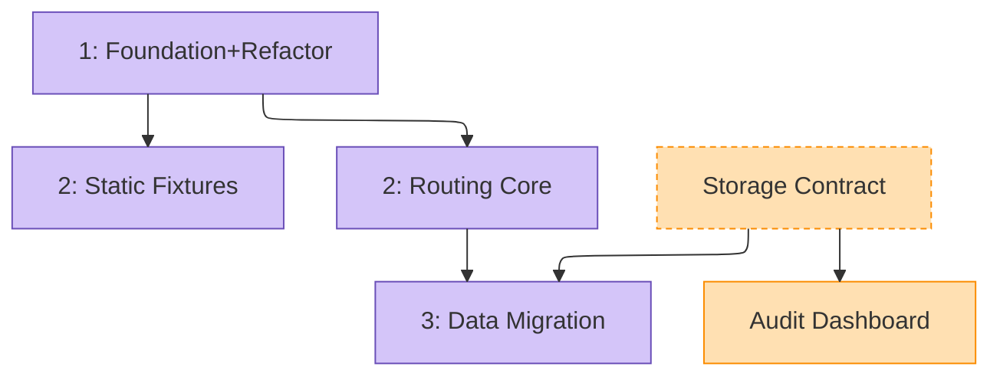

# Roadmap.md schema — table, states, views (§6–§6.9)

> Detail body of the brainstorming shared surface, read at the step named in [`common.md`](common.md).
> Section numbers are stable across the split; a § cited here that is not in this file is mapped to its file by the `common.md` index.
> `/update_roadmap` renders this file's derived blocks in its Step 3 generator run; with no generator, Step 4 renders the Mermaid block and Step 5 the derived views by hand.

---

## §6. Roadmap.md schema

Every brainstorm topic folder owns one `roadmap.md` — the routing layer above its design docs (`ideas.md`, `arch.md`, `arch-*.md`). The roadmap is **the live source of truth for sequence, state, and dependency between Parts**; design docs remain the source of truth for their content.

Maintained only by [`/update_roadmap`](../../commands/update_roadmap.md); it owns the single-executor rule.

### §6.1 Frontmatter

```yaml
---
created: YYYY-MM-DD
topic: <one-line>
scope-level: subsystem | feature | whole-game | project-game | family-index   # informs Part-granularity
parent-roadmap: ../<parent>/roadmap.md             # optional, only if nested
status: active | complete | archived
last_revised: YYYY-MM-DD
---
```

**`scope-level` vocabulary** — picks the right Part-granularity for the topic:

| Value | Meaning | Parts are sized as… |
|---|---|---|
| `subsystem` | A single named subsystem (per `project_subsystems` registry) — e.g., persistence or input routing | Impl-unit Parts (one `plan-pending` Part ≈ one plan-and-build session) |
| `feature` | A narrower scope inside a subsystem — e.g., one parser mode or one transition family | Impl-unit Parts sized by independently buildable behaviors and cohesion; no Part-count target |
| `whole-game` | Spans more than one subsystem — cross-system overhaul or retheme | Subsystem-shaped Parts per §6.9 (each row links a child roadmap) |
| `project-game` | `whole-game` scoped to the {{PROJECT_NAME}} game layer specifically, on a roadmap that sits in a tree also carrying framework (Jmodot) roadmaps | Subsystem-shaped Parts per §6.9 |
| `family-index` | An index over a family of sibling roadmaps rather than a scope of its own — rows route to members, they do not decompose work | One Part per family member, nearly all `submap-pending` |

### §6.2 Parts table

Sequence-ordered, with un-sequenced Parts below a divider rule. Parallel-safe Parts share the same `Pos` value (the Mermaid diagram shows each sequenced Part's `Pos` in its node label and draws no same-depth rank).

```markdown
## Parts

| Pos | Part | State | Deps | Trigger | Source |
|---|---|---|---|---|---|
| 1 | Foundation+Refactor | plan-pending | — | — | [[arch#Session 1 — Foundation+Refactor\|arch.md §S1]] |
| 2 | Static Fixtures | plan-pending | Foundation+Refactor | — | [[arch#Session 2 — Static Fixtures\|arch.md §S2]] |
| 2 | Routing Core | plan-pending | Foundation+Refactor | — | [[arch#Session 3 — Routing Core\|arch.md §S3]] |
| 3 | Data Migration | plan-pending | Routing Core, Storage Contract | — | [[arch#Session 4b — Data Migration\|arch.md §S4b]] |
|   | ─── unsequenced ─── |   |   |   |   |
| — | Storage Contract | idea-rework | — | next idea session | [[YYYY-MM-DD-platform-redesign/ideas#Cluster 1 — Storage Contract\|ideas.md §c1]] |
| — | Audit Dashboard | arch-pending | Storage Contract | when Storage Contract advances | [[YYYY-MM-DD-platform-redesign/ideas#Cluster 3 — Audit Dashboard\|ideas.md §c3]] |
| — | Optional Tutorial | idea-pending | — | after user trial | [[YYYY-MM-DD-platform-redesign/ideas#Optional Tutorial\|ideas.md §future]] |
```

**Columns:**
- **Pos** — the build order. Rows sharing the same `Pos` are parallel-safe at that stage. `python3 .claude/tools/roadmap_pos.py <roadmap.md> --apply` computes it from the Deps (its docstring states the rule): `complete` Parts are placed first, every other Part sits after its highest Dep, and `—` (un-sequenced) holds only `idea-pending`, `workshop-pending` and `abandoned` Parts and the Parts that depend on them. The owner may move a Part later for priority, and the tool keeps it there.
- **Part** — the stable identifier. Used in Deps cells. Renaming triggers a global rewrite via `/update_roadmap`.
- **State** — one of the states defined in §6.3 (the count lives there; don't duplicate it here).
- **Deps** — comma-separated Part names this Part blocks on. Cross-folder Deps shapes, the forbidden shapes and the `/update_roadmap rename` rewrite are owned by §6.8 below.
- **Trigger** — short ripening criterion for un-sequenced or low-maturity Parts (`—` if not applicable). Long triggers footnote into a *Trigger detail* subsection.
- **Source** — Obsidian wikilink to the originating design-doc heading: `[[<doc>#<verbatim heading>\|<short display>]]`. **Default: single most-relevant section anchor.** Even when the Part touches multiple adjacent sub-sections (e.g., §3.2-3.4), pick the most architecturally-load-bearing anchor — typically the one naming the Part's primary type, contract, or lifecycle. **Multi-anchor (`+`-separated) ONLY when the Part's commitment legitimately spans 2+ NON-ADJACENT design-doc sections.** Cross-roadmap *Part* references (rather than design-doc *section* references) follow the Deps cross-folder shape above (Parts aren't headings). Full anchor-link rules + common verbatim pitfalls: the `obsidian_conventions` skill → *Wikilinks & Heading Anchors*. `/update_roadmap` Step 3 validates anchor coherence at create/update time.

### §6.3 State vocabulary

Single field, 11 values. Phase-position is encoded in the prefix; sub-state in the suffix.

| State | Meaning | Next-phase action |
|---|---|---|
| `idea-pending` | Awaits idea brainstorm | `/idea_brainstorm` |
| `idea-rework` | Was further along, idea phase needs redo | `/idea_brainstorm` revisit |
| `arch-pending` | Has idea, awaits arch brainstorm | `/architecture_brainstorm` |
| `arch-rework` | Was further along, arch phase needs redo | `/architecture_brainstorm` revisit |
| `plan-pending` | Has arch **that resolved the Part's decisions** (Step-5 readiness gate passed; named dependencies live or scheduled). A locked seam alone, or deps that exist nowhere, is `arch-pending` | `/part_drive` |
| `submap-pending` | Decomposition delegated to a sub-roadmap (this Part on parent ≡ N Parts on child) | sub-roadmap progresses → auto-promotes to `complete` when all child Parts complete |
| `workshop-pending` | Awaits user decision (no agent action possible) | user, then re-route |
| `prototype-pending` | Blocked on a prototype answer — `prototypes/<slug>/QUESTION.md` written, verdict needs a human playing the build (the prototype workflow). The sanctioned opener for a long-horizon topic whose core feel/mechanic is unvalidated: first Part, later Parts depend on it | user runs the prototype → answer banked in `decisions.md` `## Decided` → re-route (usually `arch-pending` / `plan-pending`) |
| `user-owned` | Execution is user-domain (spatial design, manual content authoring, taste-driven tuning); no agent phase applies. Roadmap-resident — carries deps and dependents. | user builds → `complete` |
| `complete` | Shipped: built, gated, and closed by its drive's `drive_spine.md` §Close step 1, whose record the Trigger carries (§6.10) | none (terminal) |
| `abandoned` | Dropped | none (terminal) |

`user-owned` requires a Trigger naming the user deliverable. Transitions only to `complete` / `abandoned`. Distinct from `workshop-pending` (transient decision gate that re-routes to an agent phase) and from `User-Tasks.md` worklog routing (standalone items without roadmap deps).

`submap-pending` is used when a Part's scope warrants its own brainstorm-folder + roadmap (per §5.1 *deeper scope* outcome). The parent Part stays in place — preserves Deps, Source, and dependent edges — while execution moves to the child sub-roadmap. Cross-folder Deps from sibling Parts still target the parent Part name; `submap-pending` is invisible to them until the parent auto-promotes to `complete`. Its exclusion from the derived views is owned by §6.5 below. Distinct from `arch-pending`: `arch-pending` means *"never had arch brainstorm"*; `submap-pending` means *"arch DID run and produced a decomposition that lives at the linked path"*. Conflating the two erases the "came back" history that the Mermaid dashed-stroke discipline (and the Trigger field) is built to preserve.

**"Blocked" is computed, not stored.** A Part with State `*-pending` whose Deps aren't all `complete` is *effectively* blocked — rendered in the derived *Blocked* view, not stored. External (non-dep) blockers live in the Trigger column.

**No "active" states.** A Part being worked on during a session is session-internal. The roadmap records the persistent landmark (state at session end), not the working-state during.

**`plan-rework` is intentionally absent.** If plan production discovers arch gaps, the Part kicks back to `arch-rework` — one phase back.

**`plan-pending` is a design-completeness assertion, and downstream effort pins price it.** A locked seam mistaken for a designed implementer, named dependency types that exist nowhere (the Part cannot be executed as scoped), or already-shipped scope never flipped makes the state false. `/part_drive` sizes its session effort on the claim that no design ambiguity remains, so mislabeling a thin Part both under-resources its planning session and hides the arch gap that should have kicked back.

### §6.4 Embedded Mermaid diagram

`roadmap.md` includes a Mermaid block beneath the Parts table, wrapped by a `## Current state — Mermaid` heading (this heading is the structural anchor `/update_roadmap` uses to locate-and-replace the block; do not rename). **Regenerated deterministically by `/update_roadmap` on every update — never hand-edited.** Palette and styling discipline follow the `mermaid_diagrams` skill (canonical roles → roadmap class names). `roadmap_atlas.py` reads this block as its render template (its frontmatter, `graph`, comment and `classDef` lines), so an edit here changes every roadmap's next render.



Color encodes phase; dashed stroke encodes rework / abandoned / submap-pending / external. `prototype-pending` reuses the `workshop` class (both are human-gated waits). Dasharray + fill together distinguish the four dashed classes: `rework` `4 3` (tight dash, orange fill), `abandoned` `4 3` (same dash, grey fill), `submap` `8 4` (long dash, teal), `external` `6 4` (medium dash, grey — for parent-roadmap nodes referenced from sub-roadmaps per §6.12). The `external` class is used only on sub-roadmaps; combine with `-.->` (Mermaid dashed-arrow syntax) for cross-roadmap edges. The `layout: elk` frontmatter is standard for roadmaps — they grow branchy, and ELK reduces edge crossings (see the `mermaid_diagrams` skill).

**Node label rule:** a sequenced Part's label is `N: Name` (its `Pos`, a colon, the Part name verbatim); an un-sequenced Part's label is its bare name. Never `N. Name`: Mermaid's CommonMark parser interprets a leading `N. ` as an ordered-list item and emits "Unsupported markdown: list" warnings (one per offending node). The diagram draws no rank ties, so the label carries `Pos`; edges come from Deps only. Same constraint applies to leading `- ` / `* ` / `# ` / `> `. Full renderer-constraint set: [`mermaid_diagrams` skill](../mermaid_diagrams/SKILL.md) → *Renderer constraints*.

### §6.5 Derived views

Three sections rendered below the Mermaid by `/update_roadmap`. Each heading below is required verbatim — they are the structural anchors `/update_roadmap` uses to locate-and-replace each derived block; do not rename. `roadmap_atlas.py` reads this block as its render template (each heading and the definition line under it), so an edit here changes every roadmap's next render.

```markdown
## Currently ready to execute
Parts where State ∈ {idea-pending, arch-pending, plan-pending, idea-rework, arch-rework} AND every Dep has State=complete.
- Foundation+Refactor — /part_drive (Pos 1, no deps)

## Blocked / awaiting deps
Parts where State ∈ {idea-pending, arch-pending, plan-pending, idea-rework, arch-rework} blocked by incomplete deps.
- Data Migration — waiting on Routing Core (plan-pending), Storage Contract (idea-rework)
- Audit Dashboard — waiting on Storage Contract (idea-rework)

## Ready for you (user-owned)
Parts where State ∈ {user-owned, prototype-pending} AND every Dep has State=complete. Trigger names the user deliverable (for `prototype-pending`, the runtime question the user answers by playing the build).
- Example Dataset — author the representative sample files (Pos 2, no deps)
```

`submap-pending` Parts are excluded from all three derived views by design — the sub-roadmap owns the *Currently ready* / *Blocked* views for its own Parts. The parent's submap-pending Part appears only in the *Spawned sub-brainstorms* section (§6.6) pointing to the child roadmap, plus as an un-completed Dep of any sibling Part that depends on it (which then surfaces in *Blocked* — the standard mechanism).

### §6.6 Spawned sub-brainstorms

Cross-references to child docs that feed back to this roadmap or spawned their own.

```markdown
## Spawned sub-brainstorms
- `arch-parser-strategy.md` — spawned from Part "Parser Strategy" on YYYY-MM-DD. Same folder (sub-component; §5.1 criterion 3 fails). Status: brainstorming-complete.
- `../observability/roadmap.md` — sibling folder spawned YYYY-MM-DD (cross-cutting; all 3 §5.1 criteria met).
```

A child sub-roadmap's entry names at most the bare child Part count — **never a per-state breakdown**. The denormalization rule is in `roadmap_triggers_mvp.md` §6.10; a reader who wants the breakdown reads it live from the atlas (§6.13).

### §6.7 Revision log

Append-only. One line per state transition. Date-stamped.

```markdown
## Revision Log
- YYYY-MM-DD — Initial roadmap from `arch.md`. N Parts in sequence, M unsequenced.
- YYYY-MM-DD — Parser Strategy spawned `arch-parser-strategy.md` (same folder).
- YYYY-MM-DD — Storage Contract: idea-pending → idea-rework (insufficient diversity surfaced in arch attempt).
```

### §6.8 Cross-folder dep resolution

Deps can cross folders. **Canonical shape:** `Deps: (parent) <Part Name>` — short form, default, integrates with the Mermaid `external` classDef per §6.4. When the dep targets a sibling-folder roadmap (not a parent), substitute the folder slug for `parent` (e.g., `(storage) Schema Contract`). When a clickable file link adds value (typically Source cells, not Deps), use `[[../<folder>/roadmap\|<folder>]] § "<Part Name>"` — file wikilink + prose Part name.

**Forbidden:** `../<folder>/roadmap.md#<part-name>` and `[[../<folder>/roadmap#<part-name>]]`. Parts live in table rows, not `##`/`###` headings, so any `#<part>` anchor falls through silently to file-top — the canonical silent-failure mode this section's shape rules exist to prevent.

Resolution is **lazy** — `/update_roadmap` reads referenced roadmaps only when generating the *Currently-Ready* view, not on every update. Stale cross-folder state is acceptable; eager mirroring would introduce consistency bugs. The `(parent) <Part Name>` shape is also the string `/update_roadmap rename <old> <new>` rewrites vault-wide, so cross-folder identity stays in sync with renames at the source.

### §6.9 Hierarchical roadmaps (scope-level: whole-game)

For scope spanning more than one subsystem, the parent roadmap is intentionally **subsystem-shaped**, not Part-shaped: each row is a subsystem (e.g., storage, synchronization, interface), and each row's `Source` links to that subsystem's child-folder `roadmap.md`.

Child roadmaps own Part-level state; parent absorbs only subsystem-level transitions (when a whole subsystem reaches `complete`). Cross-folder edit-noise stays bounded.

```markdown
| Pos | Part (subsystem) | State | Deps | Source |
|---|---|---|---|---|
| 1 | Storage | arch-pending | — | [[../storage/roadmap\|storage]] |
| 2 | Synchronization | plan-pending | Storage | [[../synchronization/roadmap\|synchronization]] |
| 2 | Interface | plan-pending | Storage | [[../interface/roadmap\|interface]] |
| — | Optional Tutorial | idea-pending | Storage | (no folder spawned yet) |
```

